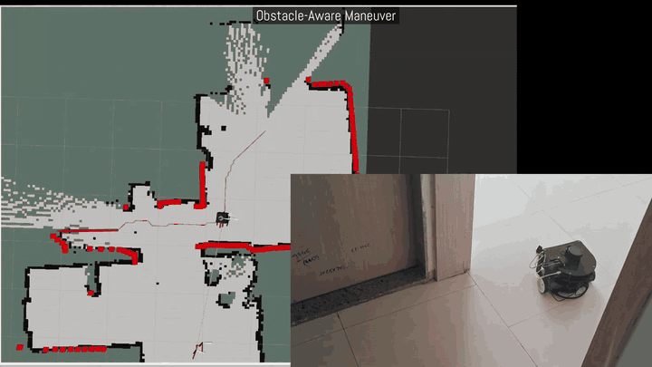
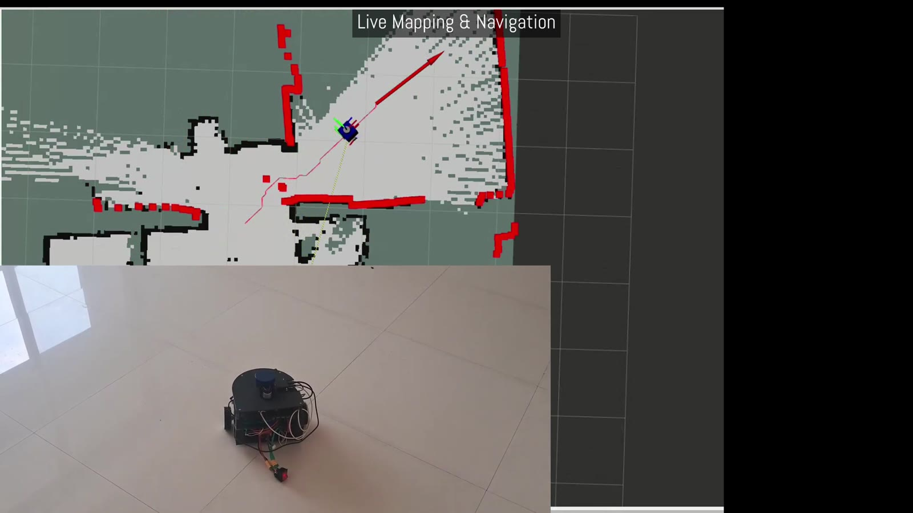
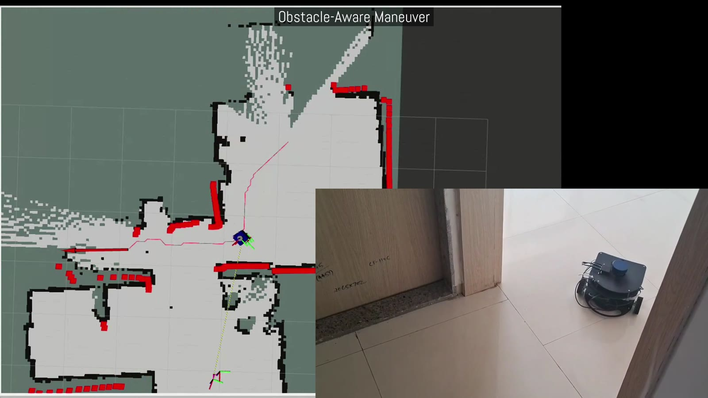
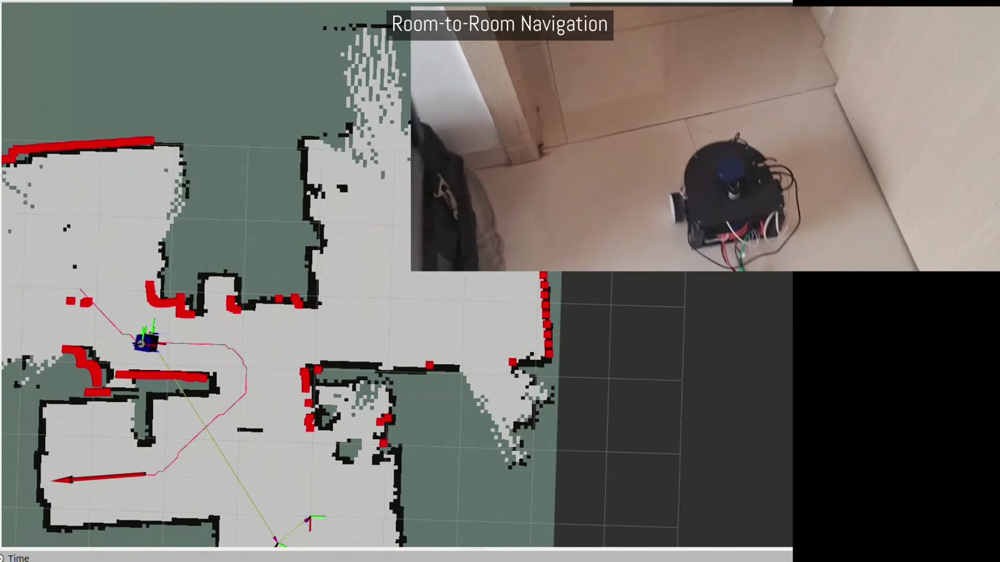

# Roomba — Autonomous Differential-Drive Robot (ROS 2 Jazzy)

A small autonomous mobile robot that maps, plans and drives on its own. A **Raspberry Pi 5** runs ROS 2 (SLAM, planning, control); an **ESP32** closes the wheel-speed loops. The same stack runs in **Gazebo simulation** (`roomba_sim.launch.xml`) or on the **real robot** (`roomba_prod.launch.xml`).

> **Status:** the full stack runs on the real robot. Motor firmware, wheel odometry and the EKF are calibrated on the floor. Navigation accuracy has been measured on **27 real floor runs**: the current pure-pursuit controller (`pure_pursuit_2`) ends **≈ 1 cm (median) from the goal in its own pose estimate** and **≈ 5 cm from the goal on a tape measure**; the remaining error is dominated by localization (IMU yaw drift). See [Experimental results](#experimental-results).

**Install, run, calibrate →** [`SETUP_AND_CALIBRATION.md`](SETUP_AND_CALIBRATION.md)

## Live maneuvering



| Live mapping | Obstacle-aware maneuver | Room-to-room navigation |
|---|---|---|
|  |  |  |

*RViz (occupancy grid, lidar scan in red, planned path) alongside the real robot. Stills are taken from the project showcase video.*

---

## Specifications

| | |
|---|---|
| Compute | Raspberry Pi 5 (ROS 2 Jazzy) + ESP32 (motor controller) |
| Drive | 2 DC motors, 2× BTS7960 drivers, OE-28 Hall quadrature encoders (5070 counts per output-shaft rev) |
| Geometry | wheel Ø 70 mm · track 240 mm · footprint 200 × 200 mm · caster at x = −0.10 m |
| Speed limit | **0.25 m/s per wheel** (≈ 0.25 m/s linear, ≈ 2.08 rad/s spin), enforced in sim and hardware |
| Sensors | YDLidar (serial, `/dev/roomba_lidar`) · BNO055 IMU (I²C bus 1, IMUPLUS mode) · wheel encoders |
| Link | ESP32 ↔ Pi: USB serial, 115200 baud, text protocol, telemetry streamed while moving (period set with `T <ms>`, 10–1000 ms, default 20 ms) |
| Software | ROS 2 Jazzy · `ros2_control` · `robot_localization` EKF · `slam_toolbox` · Gazebo (`ros_gz`) |
| Languages | Python (nodes), C++ (hardware interface), Arduino C++ (firmware) |

## How it works

```
 ESP32 firmware (v4.2)                         Raspberry Pi 5 (ROS 2 Jazzy)
┌──────────────────────┐   serial    ┌────────────────────────────────────────────────────────┐
│ per-wheel PI + FF    │◄──────────►│ roomba_hardware (ros2_control)  →  /joint_states         │
│ ramps, reversal lock │  115200    │        │                                                  │
│ 500 ms cmd watchdog  │            │   cmd_relay: wheel odometry → /odometry                   │
└──────────────────────┘            │        │              + BNO055 → /imu                      │
        ▲ encoders / PWM            │   EKF (robot_localization) → odom→roomba, /odometry/filtered
                                    │        │                                                  │
   YDLidar ─────── /scan ──────────►│   slam_toolbox → /map, map→odom                           │
                                    │        │                                                  │
                                    │   map_validator → /validated_map                          │
                                    │        │                                                  │
                                    │   frontier_explorer → /goal_pose                          │
                                    │        │                                                  │
                                    │   a_star → /path → pure_pursuit_2 → /autonomous_cmd_vel   │
                                    │        │                                                  │
                                    │   twist_mux (joystick > autonomous) → cmd_relay           │
                                    │        └─ speed limit + 0.5 s timeout → wheel commands ───┼─► ESP32
                                    └────────────────────────────────────────────────────────┘
```

- **Launch files:** four self-contained files in `program_bringup/launch/` — `roomba_sim`, `roomba_prod`, `roomba_odom_test`, `roomba_nav_test` (`.launch.xml`). Settings are launch arguments, with an `enable_<node>` switch per node.
- **One source of truth for geometry and limits:** `config/robot_dimensions.yaml` feeds the URDF, odometry, planners and avoidance.
- **TF tree:** `map → odom` (slam_toolbox) → `roomba` (EKF) → `base_link` → wheels, caster, `lidar_link`, `imu_link`. The EKF base frame is named `roomba`.
- **Safety layers:** per-wheel speed cap and 0.5 s command timeout in `cmd_relay`; 500 ms watchdog, reversal interlock and fault latch in the firmware; joystick has the highest `twist_mux` priority (99 vs 90).

### Key components

| Node / module | Role |
|---|---|
| `roomba_hardware/ESP32SystemInterface` | `ros2_control` plugin: serial link to the ESP32, publishes wheel state, sends velocity commands |
| `cmd_relay` | `/cmd_vel_unstamped` → wheel speeds (capped); wheel odometry → `/odometry` |
| `bno055_imu_node` | BNO055 → `/imu` (yaw zeroed at start after a 1.5 s settle) |
| `manager_node` | Brings up slam_toolbox / map saver, resumes saved maps, enables nodes via `/manager/enable_states` |
| `map_validator` | Pass/fail check of SLAM maps → `/validated_map` (valid flag, fail reason, map→odom jump, loop-closure flag); saves candidate maps only when valid and map→odom is not jumping |
| `frontier_explorer` / `reactive_explorer` | Exploration goals / reactive wandering |
| `a_star` (`astar2.py`) | Global planner on an 8-connected grid (0.05 m cells); `hybrid_astar` is the older lattice planner |
| `pure_pursuit_new` (`pure_pursuit_2.py`) | **Current controller** (used by all three launch files). Follows the A\* path with a lookahead, lidar avoidance and an accel/decel limiter. Within 7 cm of the path end it switches to a dedicated **parking behaviour**: proportional approach on the exact goal point (0.02–0.1 m/s, 1.5 cm enter / 3 cm exit hysteresis), reverse if the goal is just behind, rotate-in-place with hysteresis, then align to the goal yaw (2° / 4° hysteresis, 12 s timeout then gives up on yaw) |
| `trajectory_generator.py` | Pure-numpy (no ROS) path processing for the controller: snap the end to the exact goal, Douglas-Peucker, resample, curvature, speed profile with creep near the end. Importable and unit-testable on its own |
| `pure_pursuit` (legacy) | Previous controller, kept in the package (`ros2 run local_planners pure_pursuit`): rotate-in-place gate, curvature speed profile, lidar avoidance, final ALIGN state |
| `data_logger` | CSV logs to `~/roomba/collected_data` (odom, TF, joint states, wheel commands, validated map, map grids); also enabled in nav-test mode (`enable_data_logger`, default true) |
| `manual_motion_test` | Terminal tool: `straight`, `turn`, `velocity` with odometry feedback (for calibration) |

## Repository layout

```
roomba/
├── src/
│   ├── program_bringup/      4 launch files, config/*.yaml, udev rules, Gazebo world
│   ├── roomba_hardware/      ros2_control plugin for the ESP32 (C++: esp32_system_interface, serial_link)
│   ├── helpers/              Python nodes: relay, bno055, manager, map_validator, explorers, logger, manual tests
│   ├── global_planners/      a_star (octile, astar2.py) · hybrid_astar (a_star_node.py)
│   ├── local_planners/       pure_pursuit_2 (current) · trajectory_generator · pure_pursuit (legacy)
│   ├── custom_interfaces/    msgs: Validatedmap, NodeEnableStates
│   ├── urdfs/                xacro robot models (sim + hardware), RViz configs
│   └── ydlidar_ros2_driver/  vendored YDLidar ROS 2 driver
├── tools/                    experiment_analyser.py + measured_template.txt (multi-run analysis, see below)
├── esp32_codes/
│   ├── dual_motor_controller_FINAL.txt   ESP32 firmware v4.2 (flash this)
│   ├── calibration/                      open-loop calibration rig, host script, firmware simulator
│   ├── motor_tests.txt · robot_motion.py bench test sketch / serial motion script
├── saved_maps/               slam_toolbox maps (.posegraph/.data/.pgm/.yaml)
└── chirag_gujju/             Altium PCB project and Gerbers
```

## Quick start

```bash
git clone https://github.com/NOAA-dev/roomba ~/roomba      # must live at ~/roomba (see setup guide)
cd ~/roomba && colcon build --symlink-install && source install/setup.bash
ros2 launch program_bringup roomba_sim.launch.xml           # simulation (real robot: roomba_prod.launch.xml)
```

Prerequisites, ROS packages, udev rules, firmware flashing, hardware bring-up and the calibration procedure are in **[`SETUP_AND_CALIBRATION.md`](SETUP_AND_CALIBRATION.md)**. A short reference for the launch system is in [`src/program_bringup/README.md`](src/program_bringup/README.md).

## Experimental results

Each run is stored in `run_N/` (logger CSVs, saved map, and a hand-filled `measured.txt` — template in `tools/measured_template.txt`). `python3 tools/experiment_analyser.py <experiment_dir>` compiles all runs into `results/` (`results.csv`, `summary.txt`, `report.html`, plots). `--selftest` runs a synthetic check. Ground truth is a tape measure from a marked start point, so tape numbers carry roughly centimetre-level reading error.

**27 real-hardware runs** at one place (home): runs 1–14 with the previous controller, runs 15–25 and 101 with the new one. `run_111` has no `measured.txt` and is only counted in the all-runs summary. Three error measures are used throughout: *controller end error* (logged final pose vs goal — what the controller achieves in its own frame), *goal error* (tape vs goal — what really happens), and *localization error* (logged pose vs tape).

### Controller comparison (previous vs `pure_pursuit_2`)

| Metric | Previous (n = 14) | New (n = 12) | Change (mean) | p* |
|---|---|---|---|---|
| **Controller end error** (cm) | 4.2 ± 2.8 (median 3.8) | **2.1 ± 3.7 (median 0.9)** | **−51 %** | 0.006 |
| Goal error, tape (cm) | 6.0 ± 2.8 | 5.0 ± 3.5 | −16 % | 0.41 |
| Localization error (cm) | 6.3 ± 2.7 | 5.5 ± 3.4 | −13 % | 0.23 |
| Idle fraction | 0.78 | **0.56** | −28 % | 0.007 |
| Mean speed while moving (m/s) | 0.196 | 0.197 | — | 0.92 |
| Path length per run (m) | 4.6 | 8.6 | longer routes | 0.048 |
| Final map→odom drift (cm) | 9.2 ± 8.4 | 14.0 ± 7.1 | not clear | 0.10 |
| Invalid map snapshots | 1.8 % | 9.7 % | not clear | 0.12 |

**Like-for-like (return-to-start goal 0, 0 only; previous n = 6, new n = 10):** controller end error 5.4 → **2.3 cm** (median 4.1 → 0.9), tape goal error 7.5 → **5.1 cm**, localization error 8.0 → 5.8 cm. *\*Mann–Whitney; small samples, treat as a guide.* The comparison is not randomized — route mix, battery and map state differ between the groups.

What changed in practice: the robot now parks within about 1 cm of its goal (one outlier, run 16 at 13.6 cm, raises the mean), the tape improvement is smaller because **localization error now dominates**, and the robot waits less between moves (idle 78 % → 56 % at the same speed). Linear and wheel velocity gains are slightly lower with the new controller (1.01 → 0.95, 0.98 → 0.94); this may reflect its command profile rather than hardware (not yet checked).

### All 27 runs combined

| Metric | Mean ± sd | Median | Range |
|---|---|---|---|
| Goal error, tape (cm, n = 26) | 5.5 ± 3.1 | 5.2 | 1.0–13.4 |
| Controller end error (cm, n = 26) | 3.2 ± 3.3 | 2.2 | 0.4–13.6 |
| Localization error (cm, n = 26) | 5.9 ± 3.0 | 5.7 | 1.1–13.3 |
| Final map→odom drift (cm) | 11.6 ± 7.9 | 11.2 | 1.0–27.7 |
| Final drift (% of path) | 2.4 ± 1.5 | 1.8 | 0.6–6.0 |
| Path length (m) | 6.3 ± 4.7 | 6.1 | 0.9–14.4 |
| Idle fraction | 0.68 ± 0.21 | 0.70 | 0.31–0.97 |
| Linear / angular velocity gain | 0.98 / 0.67 | 1.00 / 0.70 | 0.93–1.02 / 0.39–0.84 |
| Wheel gain (mean L/R) | 0.96 | 0.97 | 0.85–1.02 |
| Stationary yaw drift (°/min) | 4.9 ± 0.8 | 4.9 | 3.8–6.5 |
| Loop-closure steps per run | 1.9 ± 2.5 | 1.0 | 0–10 |
| Invalid map snapshots | 5.3 % | 0 % | 0–41 % |

SLAM is stable: loop-closure steps are small (2–16 cm, at most about 6°) and agree with the validator's own flags to within one per run.

### Diagnosed error sources (open)

1. **Yaw drifts ≈ 4.9 °/min while the robot is stationary**, identically in odom and the map frame, in all 27 runs and independent of the controller. Confirmed from the code: the EKF takes absolute yaw only from the BNO055 (`imu0_config`: yaw), wheel odometry gives it only `vx` and `vyaw`; `bno055.py` resets the chip at every launch (calibration lost), never reads the calibration status, runs in IMUPLUS (no magnetometer) and waits only 1.5 s; and `slam_toolbox` only processes a scan after 0.25 m or 10° of motion (`minimum_travel_heading`), so it cannot correct heading while the robot is stopped. *Hypothesis:* uncorrected gyro bias. Planned fix: read `CALIB_STAT`, longer settle with the robot still, log raw gyro z while stationary.
2. **Angular velocity gain ≈ 0.67** (turns slower than wheel commands) while linear and wheel gains are ≈ 1.0. The odometry yaw rate comes from the IMU-driven EKF, so this is consistent with skid-steer slip (effective track wider than 0.24 m). *Hypothesis, unconfirmed:* a 360° in-place turn test (real vs odometry angle) will confirm or refute it; if confirmed, correct `track_width_m`.
3. **Map size** is only a fair check where the room was fully mapped (runs 2, 3, 9, 10 within about ±8 %); in other runs the map includes space outside the room or was only partly built.
4. **Measured yaw** was mostly recorded as 0, so heading error is unreliable. `run_notes` is identical across runs and out of date.

Next steps: 360° turn test, stationary IMU log and BNO055 calibration fix, repeat the experiment with measured yaw and per-run notes (battery voltage, floor), then re-compare.

## Project status

| Area | Implemented | Hardware-validated |
|---|---|---|
| ESP32 firmware (PI loops, ramps, watchdog) | ✅ | ✅ closed-loop and floor tests |
| Wheel odometry, EKF, IMU | ✅ | ✅ on-floor calibration done |
| SLAM, validator, explorers | ✅ | ✅ live mapping and exploration demonstrated |
| A\*, pure pursuit (`pure_pursuit_2`), avoidance | ✅ | ✅ 27 floor runs: ≈ 1 cm controller end error, ≈ 5 cm on tape · ⏳ turning-rate gain and stationary yaw drift to be fixed |
| Experiment logging and analysis | ✅ (`data_logger`, `tools/experiment_analyser.py`) | ✅ used on all 27 runs |
| Camera | simulation model only | — |

Known open items: the encoder constants in the firmware (5075 / 5077) differ from the 5070 used in the comments and calibration tools (confirm they are intentional); some Python dependencies are not yet declared in `package.xml` (the setup guide lists them explicitly); `robot_dimensions.yaml` `lidar.x_m` was changed from 0.10 to 0.0, while `reactive_explorer` still defaults `lidar_offset_x` to 0.1 and the legacy controller's comments assume a 0.10 m forward lidar (confirm the intended value and that all nodes agree).

## License

No license file for the project code is present in the repository. `src/ydlidar_ros2_driver` carries its own upstream license (`LICENSE.txt`).
