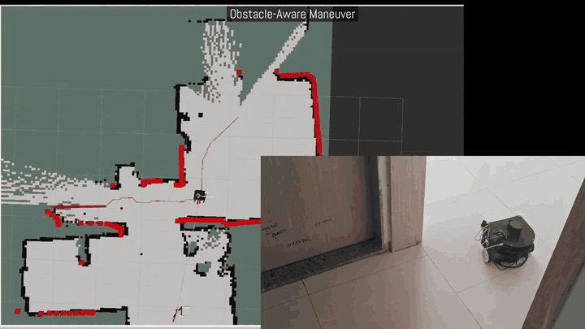
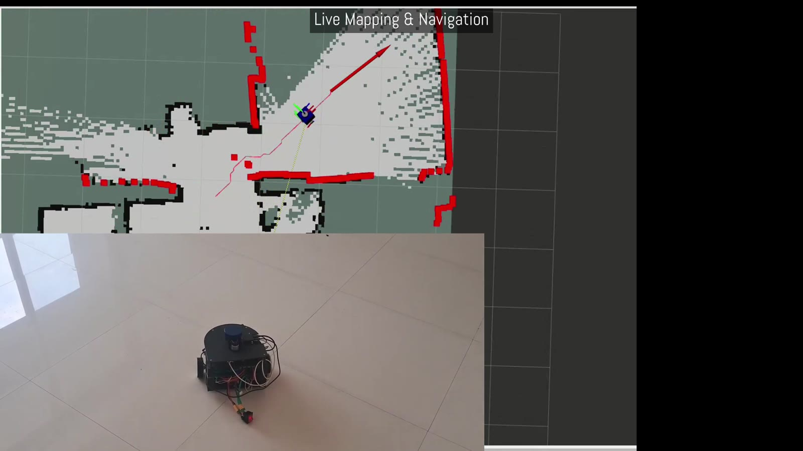
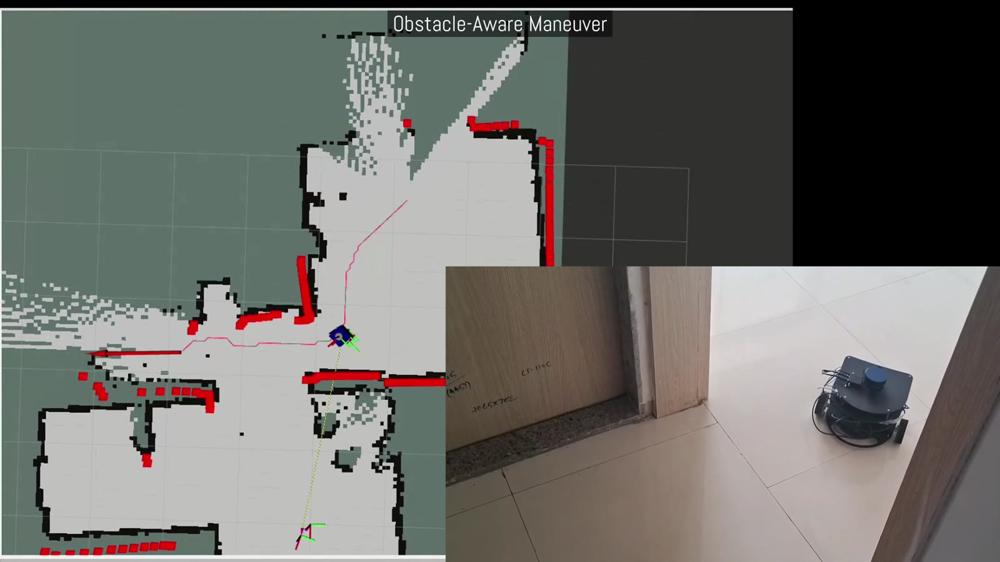
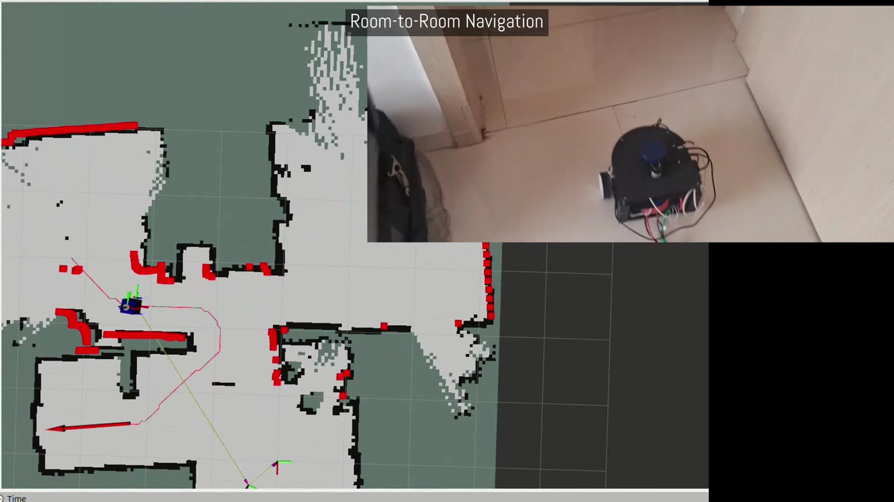

# Roomba — Autonomous Differential-Drive Robot (ROS 2 Jazzy)

A small autonomous mobile robot that maps, plans and drives on its own. A **Raspberry Pi 5** runs ROS 2 (SLAM, planning, control); an **ESP32** closes the wheel-speed loops. The same launch file runs the full stack in **Gazebo simulation** or on the **real robot**.

> **Status:** the full stack runs on the real robot. Motor firmware, wheel odometry and the EKF are calibrated on the floor, and point-to-point navigation has been tested. **Still to be tested: goal-reaching accuracy and precision** — see [Project status](#project-status).

**Install, run, calibrate →** [`SETUP_AND_CALIBRATION.md`](SETUP_AND_CALIBRATION.md)

## Live maneuvering



| Live mapping | Obstacle-aware maneuver | Room-to-room navigation |
|---|---|---|
|  |  |  |

*RViz (occupancy grid, lidar scan in red, planned path) alongside the real robot. Stills are taken from the project showcase video.*

---

## Specifications

| | |
|---|---|
| Compute | Raspberry Pi 5 (ROS 2 Jazzy) + ESP32 (motor controller) |
| Drive | 2 DC motors, 2× BTS7960 drivers, OE-28 Hall quadrature encoders (5070 counts per output-shaft rev) |
| Geometry | wheel Ø 70 mm · track 240 mm · footprint 200 × 200 mm · caster at x = −0.10 m |
| Speed limit | **0.25 m/s per wheel** (≈ 0.25 m/s linear, ≈ 2.08 rad/s spin), enforced in sim and hardware |
| Sensors | YDLidar (serial, `/dev/roomba_lidar`) · BNO055 IMU (I²C bus 1, IMUPLUS mode) · wheel encoders |
| Link | ESP32 ↔ Pi: USB serial, 115200 baud, text protocol, 50 Hz telemetry |
| Software | ROS 2 Jazzy · `ros2_control` · `robot_localization` EKF · `slam_toolbox` · Gazebo (`ros_gz`) |
| Languages | Python (nodes), C++ (hardware interface), Arduino C++ (firmware) |

## How it works

```
 ESP32 firmware (v4.2)                         Raspberry Pi 5 (ROS 2 Jazzy)
┌──────────────────────┐   serial    ┌────────────────────────────────────────────────────────┐
│ per-wheel PI + FF    │◄──────────►│ roomba_hardware (ros2_control)  →  /joint_states         │
│ ramps, reversal lock │  115200    │        │                                                  │
│ 500 ms cmd watchdog  │            │   cmd_relay: wheel odometry → /odometry                   │
└──────────────────────┘            │        │              + BNO055 → /imu                      │
        ▲ encoders / PWM            │   EKF (robot_localization) → odom→roomba, /odometry/filtered
                                    │        │                                                  │
   YDLidar ─────── /scan ──────────►│   slam_toolbox → /map, map→odom                           │
                                    │        │                                                  │
                                    │   map_validator → /validated_map                          │
                                    │        │                                                  │
                                    │   frontier_explorer → /goal_pose                          │
                                    │        │                                                  │
                                    │   a_star → /path → pure_pursuit → /autonomous_cmd_vel     │
                                    │        │                                                  │
                                    │   twist_mux (joystick > autonomous) → cmd_relay           │
                                    │        └─ speed limit + 0.5 s timeout → wheel commands ───┼─► ESP32
                                    └────────────────────────────────────────────────────────┘
```

- **Single entry point:** `ros2 launch program_bringup startup.launch.py`. `config/startup.yaml` selects `mode: sim | hardware` and which nodes run.
- **One source of truth for geometry and limits:** `config/robot_dimensions.yaml` feeds the URDF, odometry, planners and avoidance.
- **TF tree:** `map → odom` (slam_toolbox) → `roomba` (EKF) → `base_link` → wheels, caster, `lidar_link`, `imu_link`. The EKF base frame is named `roomba`.
- **Safety layers:** per-wheel speed cap and 0.5 s command timeout in `cmd_relay`; 500 ms watchdog, reversal interlock and fault latch in the firmware; joystick has the highest `twist_mux` priority (99 vs 90).

### Key components

| Node / module | Role |
|---|---|
| `roomba_hardware/ESP32SystemInterface` | `ros2_control` plugin: serial link to the ESP32, publishes wheel state, sends velocity commands |
| `cmd_relay` | `/cmd_vel_unstamped` → wheel speeds (capped); wheel odometry → `/odometry` |
| `bno055_imu_node` | BNO055 → `/imu` (yaw zeroed at start after a 1.5 s settle) |
| `manager_node` | Brings up slam_toolbox / map saver, resumes saved maps, enables nodes via `/manager/enable_states` |
| `map_validator` | Filters SLAM maps → `/validated_map`; saves final map to `~/roomba/saved_maps` |
| `frontier_explorer` / `reactive_explorer` | Exploration goals / reactive wandering |
| `a_star` (`astar2.py`) | Global planner on an 8-connected grid (0.05 m cells); `hybrid_astar` is the older lattice planner |
| `pure_pursuit` | Path tracker with rotate-in-place gate, curvature speed profile, lidar avoidance, accel limiter |
| `data_logger` | CSV logs to `~/roomba/collected_data` |
| `manual_motion_test` | Terminal tool: `straight`, `turn`, `velocity` with odometry feedback (for calibration) |

## Repository layout

```
roomba/
├── src/
│   ├── program_bringup/      launch (startup.launch.py + modules/), config/*.yaml, udev rules, Gazebo world
│   ├── roomba_hardware/      ros2_control plugin for the ESP32 (C++: esp32_system_interface, serial_link)
│   ├── helpers/              Python nodes: relay, bno055, manager, map_validator, explorers, logger, manual tests
│   ├── global_planners/      a_star (octile, astar2.py) · hybrid_astar (a_star_node.py)
│   ├── local_planners/       pure_pursuit
│   ├── custom_interfaces/    msgs: Validatedmap, NodeEnableStates
│   ├── urdfs/                xacro robot models (sim + hardware), RViz configs
│   └── ydlidar_ros2_driver/  vendored YDLidar ROS 2 driver
├── esp32_codes/
│   ├── dual_motor_controller_FINAL.txt   ESP32 firmware v4.2 (flash this)
│   ├── calibration/                      open-loop calibration rig, host script, firmware simulator
│   ├── motor_tests.txt · robot_motion.py bench test sketch / serial motion script
├── saved_maps/               slam_toolbox maps (.posegraph/.data/.pgm/.yaml)
└── chirag_gujju/             Altium PCB project and Gerbers
```

## Quick start

```bash
git clone https://github.com/NOAA-dev/roomba ~/roomba      # must live at ~/roomba (see setup guide)
cd ~/roomba && colcon build --symlink-install && source install/setup.bash
ros2 launch program_bringup startup.launch.py               # mode: sim by default
```

Prerequisites, ROS packages, udev rules, firmware flashing, hardware bring-up and the calibration procedure are in **[`SETUP_AND_CALIBRATION.md`](SETUP_AND_CALIBRATION.md)**. A short reference for the launch system is in [`src/program_bringup/README.md`](src/program_bringup/README.md).

## Project status

| Area | Implemented | Hardware-validated |
|---|---|---|
| ESP32 firmware (PI loops, ramps, watchdog) | ✅ | ✅ closed-loop and floor tests |
| Wheel odometry, EKF, IMU | ✅ | ✅ on-floor calibration done |
| SLAM, validator, explorers | ✅ | ✅ live mapping and exploration demonstrated |
| A\*, pure pursuit, avoidance | ✅ | ✅ point-to-point navigation tested · ⏳ **goal-reaching accuracy and precision** (remaining test) |
| Camera | simulation model only | — |

Known open items: the encoder constants in the firmware (5075 / 5077) differ from the 5070 used in the comments and calibration tools (confirm they are intentional), and some Python dependencies are not yet declared in `package.xml` (the setup guide lists them explicitly).

## License

No license file for the project code is present in the repository. `src/ydlidar_ros2_driver` carries its own upstream license (`LICENSE.txt`).
